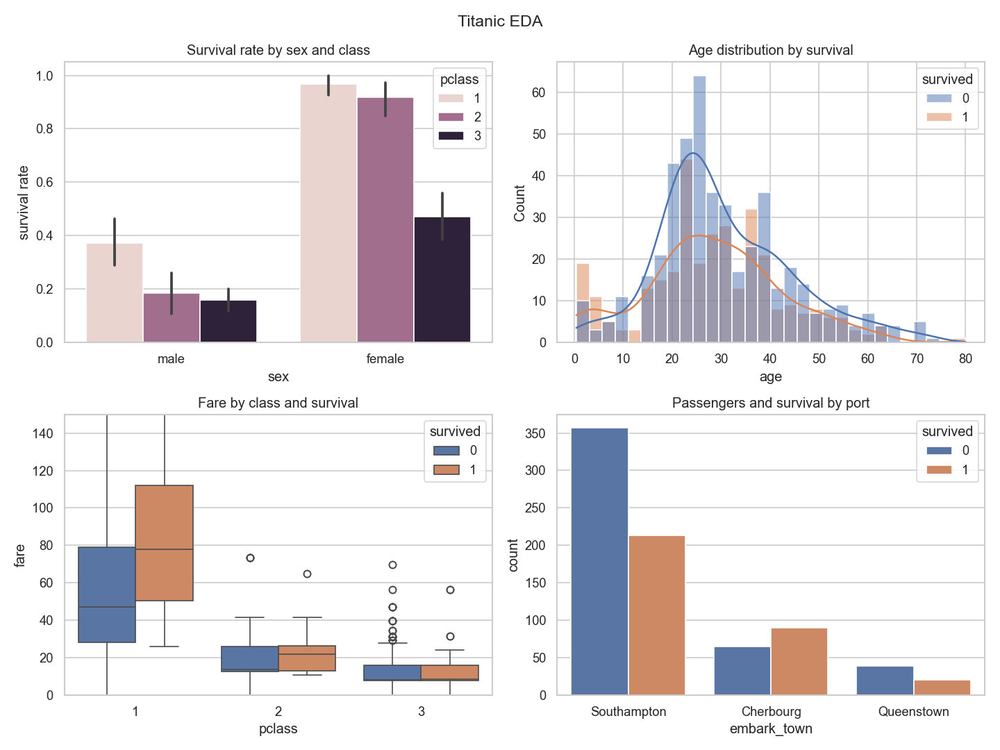

# EDA on Titanic

Exploratory Data Analysis of the classic Titanic passenger dataset using **Pandas** — covering data inspection, cleaning (missing values and duplicates), and grouping/aggregation analysis to uncover the factors that decided who survived.

## Project Overview

The goal of this project is to master the Pandas library and exploratory data-cleaning techniques through a structured, reproducible analysis pipeline:

| Step | What it does | Key Pandas tools |
|------|--------------|------------------|
| 1. DataFrame operations | Shape, memory, preview, stats summary | `head`, `info`, `describe`, `dtypes`, `value_counts`, `nunique` |
| 2. Duplicates | Detect and remove duplicate rows | `duplicated`, `drop_duplicates` |
| 3. Missing values | Quantify, visualize and treat gaps | `isna`, `drop`, `fillna`, `mode`, `groupby().transform()` |
| 4. Grouping & aggregation | Survival analysis across segments | `groupby`, `agg`, `unstack`, `pivot_table`, `crosstab`, `pd.cut`, `nlargest`, `corr`, `apply` |
| 5. Charts | Visual dashboard | `seaborn` + `matplotlib` |
| 6. Insights | Auto-generated summary of findings | — |

## Dataset

- **Source:** [seaborn-data / titanic.csv](https://raw.githubusercontent.com/mwaskom/seaborn-data/master/titanic.csv), derived from the classic Kaggle *Titanic - Machine Learning from Disaster* training set (891 passengers)
- Provided in this repo as `titanic_raw.csv` (no download needed)
- 891 rows x 15 columns: `survived`, `pclass`, `sex`, `age`, `sibsp`, `parch`, `fare`, `embarked`, `class`, `who`, `adult_male`, `deck`, `embark_town`, `alive`, `alone`

## Data Quality Findings

- **Missing values:** `deck` 74.2% (dropped), `age` 13.5% (imputed with the median age of each *pclass + sex* group), `embarked`/`embark_town` 0.3% (filled with the mode)
- **Duplicates:** 107 fully duplicated rows (12%) removed — an artifact of the identity columns (name, ticket) being stripped from this version
- After cleaning: **784 rows, 0 missing values**

## Key Insights

- Overall survival rate: **41.2%** (323 of 784)
- **Sex was the strongest factor:** women survived at **74.1%** vs men at **21.6%**
- **Wealth mattered:** 1st class **63.1%** vs 3rd class **25.7%**; 1st-class women reached **96.8%**
- **Children** (age <= 12) survived at **57.4%**
- **Traveling with family helped:** 51.2% vs 33.6% for solo travelers
- Strongest correlations with survival: `pclass` (-0.33) and `fare` (+0.25)



## How to Run

```bash
pip install pandas numpy seaborn matplotlib
python titanic_eda.py
```

The script prints all six analysis steps to the console and regenerates:

- `titanic_cleaned.csv` — the cleaned dataset (784 rows, 0 missing)
- `charts/missing_values.png` — missing values per column
- `charts/eda_dashboard.png` — 4-panel analysis dashboard

## Project Structure

```
EDA-on-Titanic/
|-- README.md
|-- titanic_eda.py        # full EDA pipeline (6 steps)
|-- titanic_raw.csv       # raw dataset (891 x 15)
|-- titanic_cleaned.csv   # cleaned dataset (784 x 17)
`-- charts/
    |-- missing_values.png
    `-- eda_dashboard.png
```

## Requirements

- Python 3.10+
- pandas, numpy, seaborn, matplotlib
